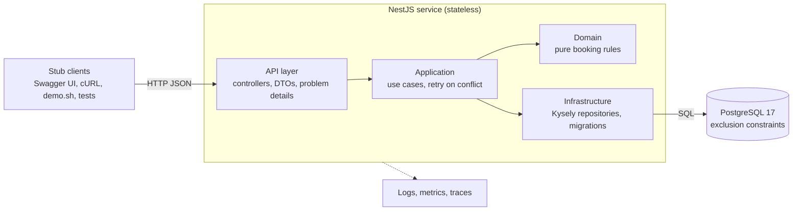
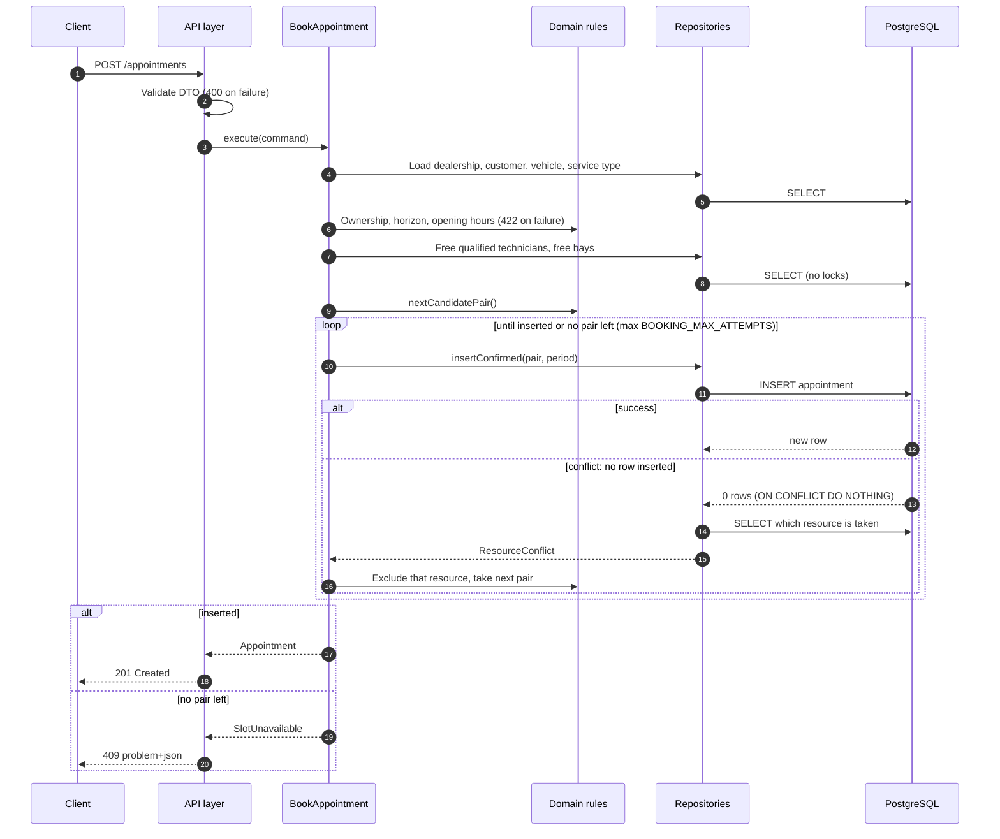

# System design: Unified Service Scheduler

Backend for the Keyloop Technical Assessment, Scenario A. The step-by-step build and the full specification are in [implementation-guide.md](implementation-guide.md); decisions are recorded as ADRs in [adr/](adr/).

## Context

A dealership group wants customers (or agents acting for them) to book a service appointment for a specific vehicle, service type and dealership at a chosen time. A booking is only valid if, for the **whole** service duration, the dealership has a free **service bay** and a free **technician qualified** for that service type.

| ID | Requirement (from the brief) | Where it lives |
| --- | --- | --- |
| A1 | Request an appointment for a vehicle, service type and dealership at a desired time | `POST /appointments` |
| A2 | Before confirming, check a ServiceBay and a qualified Technician are both available for the entire duration | Booking use case + PostgreSQL exclusion constraints |
| A3 | On success, persist an Appointment associating customer, vehicle, technician and bay | `appointment` table, `GET /appointments/{id}` |

The brief's backend option also asks for a RESTful API, a persistent database, a stubbed client (OpenAPI, cURL, test harness) and attention to scalability, performance, reliability, maintainability and observability.

## Assumptions

The full list, AS1–AS16, is in the guide's [Assumptions](implementation-guide.md#assumptions-the-code-must-implement) table. The ones that shape the design most:

- **AS2** The customer and vehicle already exist, and the vehicle must belong to the customer (422 otherwise).
- **AS4, AS5** Bays are interchangeable within a dealership. A technician works at one dealership, during its opening hours, with no shifts or breaks.
- **AS6** Weekly opening hours are kept in the dealership's IANA time zone, and a service must fit inside one local day.
- **AS7** The requested start is never shifted. If it is not free the answer is 409, with alternatives.
- **AS8, AS12** Times are stored in UTC as half-open periods `[start, start + duration)` with no changeover buffer, so back-to-back bookings are allowed.
- **AS9** First-fit allocation in a stable order ([ADR-003](adr/0003-allocation-strategy.md)).
- **AS10** A booking is confirmed immediately. Only CONFIRMED appointments block resources.
- **AS11** A start must be in the future and within `BOOKING_HORIZON_DAYS` (90).
- **AS14** A vehicle cannot have two overlapping confirmed appointments.

Decisions made while building, beyond the guide:

- Availability and alternatives leave out starts beyond the booking horizon, so the API never suggests a time it would then reject.
- The idempotency fingerprint is the SHA-256 of the request body as canonical JSON (sorted keys), as sent: the same instant written with a different offset counts as a different body.
- Unmatched routes and other framework HTTP errors use the HTTP status name as `code` (for example `NOT_FOUND`), since the guide's code table covers application errors only.

## Architecture

A stateless NestJS service in four layers. Dependencies point inwards to a framework-free domain, and ESLint (`no-restricted-imports` per folder) fails the build on a violation.

| Layer | Path | May import | Enforced |
| --- | --- | --- | --- |
| Domain | `src/domain` | Plain TypeScript, `luxon` | No `@nestjs/*`, `kysely`, `pg` or other layers |
| Application | `src/application` | Domain, its ports, `@nestjs/common` for DI | No `kysely`, `pg`, infrastructure or api |
| Infrastructure | `src/infrastructure` | Ports, domain, `kysely`, `pg` | No api |
| API | `src/api` | Application, domain | No `kysely`, `pg` or infrastructure |

`src/app.module.ts` is the composition root: it binds every port (`SchedulingRepository`, `AppointmentRepository`, `Clock`, `BookingPolicy`, `BookingTelemetry`, `ReadinessCheck`, `MetricsExporter`) to its adapter. The application layer therefore never sees Kysely, prom-client, pino or OpenTelemetry, and tests swap adapters freely (for example a `FixedClock`).

## Components

| Component | File | Role |
| --- | --- | --- |
| Appointments controller | `api/appointments.controller.ts` | `POST /appointments` (201 + `Location`; 200 replay with `Idempotency-Key`), `GET /appointments/{id}`, `POST /appointments/{id}/cancel` |
| Availability controller | `api/availability.controller.ts` | `GET /dealerships/{id}/availability?serviceTypeId=&date=` |
| Health and metrics | `api/health.controller.ts`, `api/metrics.controller.ts` | `/health/live`, `/health/ready` (503 when `SELECT 1` fails or exceeds 1 s), `/metrics` |
| Validation | `api/validation.pipe.ts`, `api/dto/*` | class-validator DTOs; `startsAt` must carry an offset; unknown fields rejected |
| Problem details | `api/problem-details.filter.ts` | Every error becomes RFC 9457 `application/problem+json` with a stable `code` and `requestId`; no stack traces |
| Request ID | `api/request-id.ts` | Accepts a safe `X-Request-Id` or generates a UUID; echoed in the response and logs |
| BookAppointment | `application/book-appointment.use-case.ts` | Steps 0–9 of the booking algorithm, bounded retries, alternatives on 409 |
| Queries and cancel | `application/get-appointment.query.ts`, `get-availability.query.ts`, `cancel-appointment.use-case.ts` | Read model, availability, idempotent cancel |
| Domain rules | `domain/period.ts`, `opening-hours.ts`, `allocation.ts`, `availability.ts` | Half-open periods, opening hours in the dealership zone (DST-safe), first-fit pairing, available starts and alternatives |
| Repositories | `infrastructure/repositories/*` | Lock-free candidate queries; the booking insert; SQLSTATE mapping |
| Database | `infrastructure/database/*` | Kysely over a `pg` pool, migration `0001`, idempotent seed, readiness |
| Observability | `infrastructure/observability/*`, `src/tracing.ts` | pino logs, Prometheus metrics, OpenTelemetry spans |

## Data flow

### Booking (A1, A2, A3)

1. **Idempotency (optional).** With an `Idempotency-Key`, a stored appointment with the same body fingerprint is replayed (200, `Idempotent-Replayed: true`); a different body gets 422.
2. **Context.** Dealership with opening hours, customer, vehicle and service type are loaded in parallel (404 for any unknown). The vehicle must belong to the customer (422).
3. **Rules.** Period `[start, start + duration)`; start in the future and within the horizon; the whole period inside that local day's opening hours, evaluated with Luxon in the dealership's IANA zone (422).
4. **Fast paths.** A CONFIRMED overlap for the vehicle gives 409 `VEHICLE_ALREADY_BOOKED`. Free qualified technicians and free bays are read with `NOT EXISTS` over CONFIRMED appointments whose period overlaps (`&&`) a `'[)'` range, ordered by name then id. These reads take no locks and are only optimisations.
5. **Decision.** `nextCandidatePair` picks the first technician and bay not excluded. One autocommit `INSERT … ON CONFLICT DO NOTHING` writes the row unless an exclusion constraint (bay, technician, vehicle) or the idempotency index rejects it. On no row, the repository reads which committed row holds the resource. A taken bay or technician is excluded and the next pair tried; a taken vehicle is 409; a taken key returns to step 1. At most `BOOKING_MAX_ATTEMPTS` lost races.
6. **Outcome.** 201 with the stored record, or 409 `SLOT_UNAVAILABLE` with up to `ALTERNATIVES_COUNT` free starts found by scanning forward in `SLOT_STEP_MINUTES` steps for up to `ALTERNATIVES_SEARCH_DAYS` days, skipping the vehicle's own busy times.

### Concurrency: why the database decides

Two requests for the last free bay can both pass every read. The guarantee is the three partial exclusion constraints on `appointment` (`EXCLUDE USING gist (… WITH =, period WITH &&) WHERE (status = 'CONFIRMED')`), so a double booking is impossible whatever the application does ([ADR-001](adr/0001-database-enforced-no-overlap.md)). The concurrency tests prove it: 50 parallel requests for one bay and technician give exactly one 201, five times in a row. With the bay and technician constraints dropped, the same test confirms 16 bookings for one bay.

The insert is `ON CONFLICT DO NOTHING` rather than a plain `INSERT` because stress testing showed the plain form livelocks. Concurrent conflicting inserts each write their exclusion-index entry before checking, so they wait on each other and PostgreSQL must abort deadlock victims; with many racers, nobody commits. Speculative insertion checks first and lets only the older of two racers wait, which removed the problem (details and numbers in ADR-001). As defence in depth, the pool sets `lock_timeout = 2s`, and a statement aborted as a deadlock victim or by the timeout is retried after jittered exponential backoff, under its own bound of 15, after re-reading the candidates.

### Reading, availability and cancellation

- `GET /appointments/{id}` joins the six associated records and returns UTC instants plus the same instants in the dealership's zone. Only the customer's name is returned, never contact details.
- `GET /dealerships/{id}/availability` loads that local day's confirmed bookings in one range query and runs the pure `computeAvailableStarts`. Each start carries the offset for that day, so 24 Oct 2026 shows `+01:00` and 25 Oct shows `+00:00` in London.
- `POST /appointments/{id}/cancel` sets CANCELLED and `cancelled_at` (from the `Clock` port), guarded by `status = 'CONFIRMED'`. It is idempotent, and the partial constraints immediately free the slot.

### Time zones and daylight saving

All instants are stored as `timestamptz` (UTC). Opening hours are wall-clock times in the dealership's IANA zone; each local day's opening and closing instants are computed with Luxon, which resolves the right offset on either side of a clock change (unit tests UT-OH-06 and SH-AV-02 cover 25 Oct 2026 in London). Candidate starts step forward from opening time. Times that do not exist or occur twice on a change day fall at 01:00–02:00 local, outside the seeded opening hours, so they never arise. A dealership open across a change would see its steps follow absolute time through the jump. The API rejects a `startsAt` without an explicit offset, so a local time is never guessed.

## Technology choices

| Concern | Choice | Why |
| --- | --- | --- |
| Runtime | Node.js 24 LTS, TypeScript strict + `noUncheckedIndexedAccess` | Current LTS; strict types catch nulls and missing cases at build time |
| Framework | NestJS 11 | DI makes ports and adapters natural; mature validation, OpenAPI and testing support |
| Database | PostgreSQL 17 with `btree_gist` | Range types and exclusion constraints give a declarative, race-proof no-overlap rule |
| Data access | Kysely over `pg` | Type-safe SQL that keeps PostgreSQL features (`tstzrange`, `&&`, `ON CONFLICT`) visible; no ORM magic in the critical path |
| Time zones | Luxon | IANA zones and DST-correct arithmetic, used only inside the domain |
| Validation | class-validator, class-transformer | Declarative DTO rules that also drive the OpenAPI schema |
| API docs | @nestjs/swagger, yaml | Spec generated from the code, exported to `openapi.yaml`, drift-checked in CI |
| Logging | nestjs-pino, pino-http | Fast structured JSON with per-request child loggers |
| Metrics | prom-client | De facto Prometheus client, default process metrics included |
| Tracing | OpenTelemetry Node SDK, OTLP HTTP | Vendor-neutral; auto-instruments HTTP, Express and pg |
| Tests | Jest, ts-jest, Supertest, Testcontainers | Real PostgreSQL in tests, because the constraints are the guarantee and cannot be mocked |
| Quality | ESLint 9 flat config, typescript-eslint, Prettier | Layer rules enforced by lint, not by review |

Pinned versions are in [ADR-002](adr/0002-technology-stack.md).

## Observability

Logs explain one request, metrics show the system, traces show where time goes. The request ID and trace ID join them. None of the three contains personal data: IDs only, never names, emails, phone numbers or VINs.

- **Logs.** pino JSON on stdout. Every line written while handling a request carries `requestId` (taken from a safe `X-Request-Id` header or generated, and echoed in the response and in problem details). Authorization and cookie headers are redacted, bodies are never logged, and health and metrics polls are not logged. One `booking.decided` line per booking records `outcome`, `errorCode`, `retries`, `dealershipId`, `serviceTypeId`, `appointmentId` and `durationMs`. With tracing on, every line also carries `trace_id` and `span_id`.
- **Metrics** at `/metrics`: `booking_requests_total{outcome}`, `booking_conflict_retries_total{resource}`, `booking_duration_seconds`, and `http_server_request_duration_seconds{method,route,status_code}`. The route label is the template (`/appointments/:id`), never the raw URL. Default process metrics are included. Labels never contain IDs.
- **Traces** (`OTEL_ENABLED=true`). HTTP, Express and pg auto-instrumentation plus two custom spans: `booking.execute` (`dealership.id`, `service_type.id`) and `booking.insert_attempt` (`attempt`, `outcome`). `docker compose --profile tracing up` adds Jaeger at `http://localhost:16686`.
- **Health.** `/health/live` while the process runs; `/health/ready` runs `SELECT 1` within one second and returns 503 otherwise, so an orchestrator stops routing traffic during a database outage. Shutdown hooks destroy the pool and flush spans. An idle-client error handler keeps a database restart from crashing the process; this was found during testing.

## Build for the future

| Quality | Built now | Roadmap |
| --- | --- | --- |
| Scalability | Stateless service, so any number of instances can run behind a load balancer. Correctness under concurrency rests on database constraints, not on in-process state. Pool size is configurable. | Read replicas for availability queries; partition `appointment` by dealership or month; cache reference data |
| Performance | Candidate queries use GiST indexes (`appointment_dealership_period_idx` and the exclusion indexes). One insert decides. Context loads run in parallel. | Load test with k6; precompute availability; pagination if lists grow |
| Reliability | Constraints prevent double booking. Idempotency keys make client retries safe. Bounded retries. Readiness probe. Graceful shutdown. Survives a database restart. | Outbox for notifications; circuit breaker on the database; multi-region read path |
| Maintainability | Four layers enforced by lint. Ports and adapters. Pure domain with unit tests. OpenAPI generated and drift-checked. ADRs. Tests named by requirement ID. | Contract tests for clients; mutation testing (StrykerJS) in CI |
| Observability | Structured logs with request and trace IDs, Prometheus metrics, OpenTelemetry traces | Dashboards and alerts (SLO on booking latency and 5xx rate); log shipping |
| Security | Input validation, parameterised SQL only, no personal data in logs, non-root container | Authentication and roles (out of scope here), rate limiting, secrets manager |

## GenAI in the design phase

<!-- Jeremy: write this section in your own words (Step 13). Suggested points:
     - How you used AI to stress-test the assumptions (AS1–AS16) and which ones you changed.
     - How the guide, CLAUDE.md, the reviewer subagent, /step and the hooks constrained the AI.
     - What you verified by hand, and what the AI got wrong (see docs/ai-collaboration/verification-log.md).
     - The concurrency story: plain INSERT livelock found by stress testing, and the switch to ON CONFLICT DO NOTHING. -->

## Production roadmap

1. Authentication and authorisation (customer, agent and dealership roles) in front of the API.
2. Customer, vehicle and reference-data management APIs; rescheduling.
3. Technician shifts, breaks and skills matrices; changeover buffers per bay.
4. Notifications (email/SMS) through a transactional outbox.
5. Rate limiting and abuse protection on booking.
6. SLOs, dashboards and alerting on the metrics above; centralised logs and traces.
7. Zero-downtime migrations and blue-green deploys; backups and point-in-time recovery for PostgreSQL.
