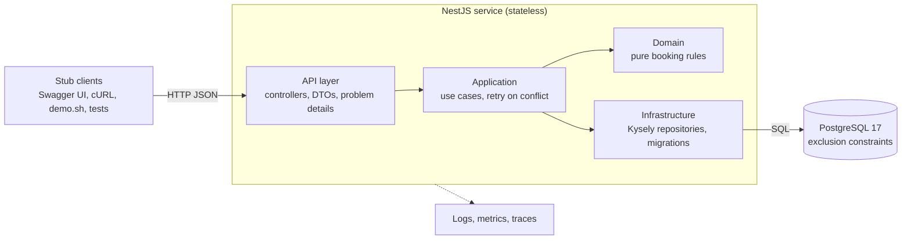
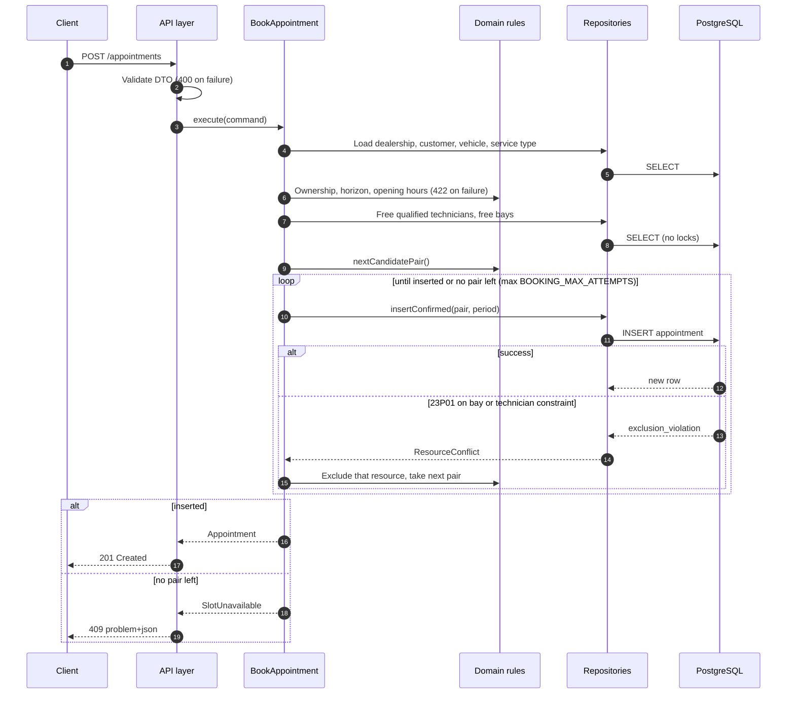

# System design: Unified Service Scheduler

> Skeleton created in Step 1. Completed in Step 13.

## Context

## Assumptions

## Architecture

## Components

## Data flow

## Technology choices

## Observability

## Build for the future

## GenAI in the design phase

## Production roadmap
